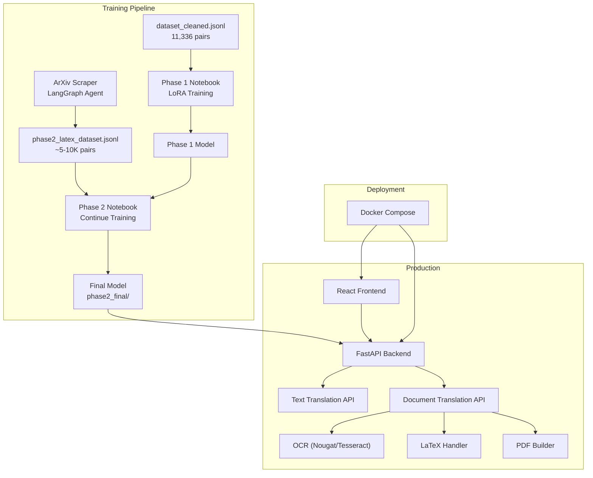

# MathTrans — Full Project Implementation Plan

## Background

The project builds a **mathematical document translation system** (English ↔ Arabic) using a fine-tuned `facebook/nllb-200-1.3B` model with LoRA adapters. Phase 1 training has already been completed on `phase1_v3_final_dataset.jsonl` (~75K pairs) in the existing `MathTrans_Full.ipynb`. Now we need to:

1. **Retrain Phase 1** on `dataset_cleaned.jsonl` (11,336 samples) with optimized hyperparameters
2. **Scrape arXiv** for LaTeX-aware math paper data
3. **Train Phase 2** on LaTeX-placeholder data
4. Build a **FastAPI backend** with OCR-based PDF translation
5. Build a **React + TypeScript frontend**
6. Deploy everything in **Docker Compose**

---

## User Review Required

> [!IMPORTANT]
> **OpenAI API Key exposed** — The key `sk-proj-oaMteFCk...` was provided in the request. I will use it in the scraping pipeline but **strongly recommend rotating it** after development since it will be in source code.

> [!WARNING]
> **Nougat OCR vs GOT-OCR**: Nougat is excellent for English scientific PDFs (outputs Markdown+LaTeX). GOT-OCR2.0 is promising but has limited Arabic support. For Arabic PDFs, we'll use **Tesseract with Arabic language pack** as a reliable fallback, since GOT-OCR Arabic fine-tuning data is scarce. If you have a specific GOT-OCR model path or want to try it anyway, let me know.

> [!IMPORTANT]
> **GPU requirement**: Phase 1 & 2 training notebooks are designed for **Google Colab T4 GPU**. The scraping pipeline and FastAPI service run on CPU. Docker deployment assumes the model weights are pre-built (inference is CPU/GPU agnostic via `torch.device`).

## Open Questions

1. **Colab vs Local training?** The existing notebook targets Colab T4. Should the new Phase 1 notebook also target Colab, or do you have a local GPU?
2. **Phase 2 data volume target?** I'll aim for ~5,000-10,000 LaTeX-placeholder pairs from arXiv scraping. Is that sufficient?
3. **GOT-OCR for Arabic**: Do you have a specific GOT-OCR model or checkpoint? If not, I'll use Tesseract Arabic as the OCR backend for Arabic PDFs.
4. **Domain for frontend deployment?** Or is `localhost` sufficient for now?

---

## Proposed Changes

### Component 1 — Phase 1 Training Notebook

#### [NEW] [MathTrans_Phase1_Clean.ipynb](file:///c:/Users/dell/Desktop/Math_AI_translation/MathTrans_Phase1_Clean.ipynb)

Interactive Colab notebook for training on `dataset_cleaned.jsonl` (11,336 samples). Each cell is self-contained with example outputs.

**Hyperparameter Choices & Rationale:**

| Parameter | Value | Rationale |
|---|---|---|
| `r` (LoRA rank) | **16** | Same as Phase 1 — proven stable for NLLB-1.3B |
| `lora_alpha` | **32** | α/r = 2.0 — standard effective scaling |
| `target_modules` | `q_proj, k_proj, v_proj, out_proj` | Covers full attention; proven in Phase 1 |
| `lora_dropout` | **0.1** | ↑ from 0.05 — 11K samples needs more regularization |
| `per_device_train_batch_size` | **4** | T4 safe at seq_len=256 |
| `gradient_accumulation_steps` | **8** | Effective batch = 32 (smaller dataset → smaller effective batch) |
| `learning_rate` | **5e-4** | Higher LR for smaller dataset — converge faster |
| `lr_scheduler_type` | `cosine` | Smooth decay, prevents plateaus |
| `warmup_ratio` | **0.1** | ~10% warmup (≈50 steps) for 11K dataset |
| `num_train_epochs` | **5** | More epochs for small dataset |
| `weight_decay` | **0.01** | Standard regularization |
| `eval_steps` | **100** | Evaluate more frequently (small dataset) |
| `save_steps` | **100** | Save every 100 steps → sweep ALL checkpoints |
| `save_total_limit` | **None** | Keep ALL checkpoints for sweep |
| `val_split` | **0.1** | 10% validation (≈1,134 samples) — larger split for reliable val signal |
| `max_source_length` | **256** | Covers 99%+ of sentences |
| `predict_with_generate` | **True** | Enable chrF++/BLEU computation at each eval |
| `eval_num_beams` | **1** | Greedy for speed during training eval |

**Notebook Sections:**

1. **Cell 1**: Install dependencies
2. **Cell 2**: Mount Drive / Setup paths
3. **Cell 3**: Load & inspect dataset — show 3 random examples
4. **Cell 4**: Tokenizer + Model + LoRA setup — show trainable params
5. **Cell 5**: Tokenize + inspect token lengths
6. **Cell 6**: Training loop with `SaveCurvesCallback` — saves ALL checkpoints + final model
7. **Cell 7**: Pick 3 random examples from train & validation — show base model vs fine-tuned output
8. **Cell 8**: Per-checkpoint chrF++ & BLEU bar chart (sweep all checkpoints)
9. **Cell 9**: Training curves — Train Loss + Validation Loss on same plot (overfitting detection)
10. **Cell 10**: Train chrF++ curve (separate plot)
11. **Cell 11**: Final side-by-side comparison table (Base vs Fine-tuned, 3 train + 3 val examples)

---

### Component 2 — ArXiv Web Scraping Pipeline (LangGraph Agent)

#### [NEW] [scrape_arxiv_math.py](file:///c:/Users/dell/Desktop/Math_AI_translation/scrape_arxiv_math.py)

A **LangGraph agent** that:

1. **Searches arXiv** for math papers across categories (math.AG, math.AP, math.CA, math.CO, math.DG, math.FA, math.NT, math.PR, math.ST)
2. **Fetches HTML** from `ar5iv.labs.arxiv.org/html/{paper_id}`
3. **Extracts text** from HTML, splitting into sentences
4. **Replaces LaTeX** (from `<math>` tags / `$...$` / `\(...\)`) with `<MATH_0>`, `<MATH_1>`, etc. placeholders
5. **Validates** sentence length (10-500 chars), ensures it's valid English text
6. **Translates** each English sentence to Arabic using **OpenAI GPT-4o-mini** (cost-effective)
7. **Creates bilingual pairs** in both directions:
   ```json
   {"source": "<en2ar> If <MATH_0> is a reduced curve...", "target": "إذا كان <MATH_0> منحنىً مخفضًا..."}
   {"source": "<ar2en> إذا كان <MATH_0> منحنىً مخفضًا...", "target": "If <MATH_0> is a reduced curve..."}
   ```
8. **Deduplicates** and saves to `data/phase2_latex_dataset.jsonl`

**LangGraph State Machine:**
```
[search_papers] → [fetch_html] → [extract_text] → [replace_latex] → [validate] → [translate] → [format_pairs] → [save]
```

**Target**: ~5,000-10,000 bilingual pairs from ~50-100 papers

**Key design decisions:**
- Uses `ar5iv` HTML (not PDF) because it preserves `<math>` tags with actual LaTeX — much cleaner extraction
- GPT-4o-mini for translation at ~$0.15/1M input tokens — affordable for 10K sentences
- Regex + BeautifulSoup for LaTeX detection in HTML `<math>` elements
- Sentence-level splitting with spaCy or regex

---

### Component 3 — Phase 2 Training Notebook

#### [NEW] [MathTrans_Phase2_LaTeX.ipynb](file:///c:/Users/dell/Desktop/Math_AI_translation/MathTrans_Phase2_LaTeX.ipynb)

Picks up the **Phase 1 final model** and continues training on LaTeX-placeholder data.

**Phase 2 Hyperparameters & Rationale:**

| Parameter | Value | Rationale |
|---|---|---|
| `learning_rate` | **2e-4** | Lower than Phase 1 — fine-tuning on top of already fine-tuned model |
| `num_train_epochs` | **3** | Conservative — avoid catastrophic forgetting of Phase 1 knowledge |
| `lora_dropout` | **0.1** | Same regularization |
| `warmup_ratio` | **0.1** | Standard warmup |
| `gradient_accumulation_steps` | **8** | Effective batch=32 |
| `save_total_limit` | **None** | Keep all checkpoints |
| `eval_steps` | **100** | Frequent evaluation |

**Notebook Sections:**
1. Install + Mount Drive
2. Load Phase 1 final model (merged weights)
3. Apply fresh LoRA adapters on top
4. Load + inspect Phase 2 dataset — show examples with `<MATH_X>` placeholders
5. Tokenize + verify placeholders survive tokenization
6. Train with all checkpoints
7. 3 random examples: base → Phase 1 → Phase 2 comparison
8. Per-checkpoint chrF++ & BLEU bar chart
9. Training curves (loss + val loss)
10. Final merge → `phase2_final/`

---

### Component 4 — FastAPI Backend

#### [NEW] [backend/](file:///c:/Users/dell/Desktop/Math_AI_translation/backend/)

```
backend/
├── app/
│   ├── __init__.py
│   ├── main.py              # FastAPI app, CORS, routes
│   ├── config.py             # Settings, model paths
│   ├── routers/
│   │   ├── __init__.py
│   │   ├── translate.py      # /translate endpoint (text)
│   │   └── document.py       # /translate/document endpoint (PDF)
│   ├── services/
│   │   ├── __init__.py
│   │   ├── model_service.py  # Load model, translate function
│   │   ├── ocr_service.py    # Nougat (EN) + Tesseract (AR) OCR
│   │   ├── latex_handler.py  # Replace/restore LaTeX placeholders
│   │   └── pdf_builder.py    # Build output PDF with structure
│   └── utils/
│       ├── __init__.py
│       └── text_utils.py     # RTL/LTR handling, sentence splitting
├── Dockerfile
└── requirements.txt
```

**Key endpoints:**
- `POST /api/translate` — Text translation (JSON body: `{text, direction}`)
- `POST /api/translate/document` — PDF upload → translated PDF download

**PDF Pipeline:**
1. **Input PDF** → Nougat OCR (English) or Tesseract+Arabic (Arabic)
2. **Extract structure** — headers, paragraphs, tables, equations
3. **Replace LaTeX** with `<MATH_N>` placeholders, store mapping
4. **Translate** each text segment
5. **Restore LaTeX** from mapping
6. **Build output PDF** with `reportlab` / `fpdf2` — matching structure, proper RTL/LTR, Arabic font support

---

### Component 5 — React + TypeScript Frontend

#### [NEW] [frontend/](file:///c:/Users/dell/Desktop/Math_AI_translation/frontend/)

Modern professional UI with:
- **File upload** (drag & drop PDF)
- **Text translation** mode (textarea with direction toggle)
- **Real-time progress** for document processing
- **Side-by-side** original/translated preview
- **Download** translated PDF
- Dark/light mode, glass morphism, Inter font, smooth animations

```
frontend/
├── src/
│   ├── App.tsx
│   ├── index.css
│   ├── components/
│   │   ├── Header.tsx
│   │   ├── TextTranslator.tsx
│   │   ├── DocumentTranslator.tsx
│   │   ├── DirectionToggle.tsx
│   │   ├── ProgressOverlay.tsx
│   │   └── ResultViewer.tsx
│   ├── hooks/
│   │   └── useTranslation.ts
│   └── services/
│       └── api.ts
├── Dockerfile
├── package.json
└── tsconfig.json
```

---

### Component 6 — Docker Compose

#### [NEW] [docker-compose.yml](file:///c:/Users/dell/Desktop/Math_AI_translation/docker-compose.yml)

```yaml
services:
  backend:
    build: ./backend
    ports: ["8000:8000"]
    volumes: ["./models:/app/models"]  # Mount model weights
  frontend:
    build: ./frontend
    ports: ["3000:80"]
    depends_on: [backend]
```

#### [MODIFY] [requirements.txt](file:///c:/Users/dell/Desktop/Math_AI_translation/requirements.txt)

Update with all project dependencies.

---

## Architecture Diagram



---

## Verification Plan

### Automated Tests
- **Phase 1**: Run training, verify loss decreases, chrF++ > baseline, all checkpoints saved
- **Phase 2**: Verify model handles `<MATH_N>` placeholders correctly in translation
- **Scraper**: Run on 5 papers, verify output format matches spec
- **Backend**: `pytest` tests for `/translate` and `/translate/document` endpoints
- **Frontend**: Build succeeds, renders in browser

### Manual Verification
- Run the training notebook cells 1-by-1, verify each output
- Upload a sample math PDF through the frontend, verify translated PDF output
- Check RTL rendering in Arabic output PDFs
- Verify LaTeX equations are preserved through round-trip translation

---

## Execution Order

| Step | Component | Est. Time |
|------|-----------|-----------|
| 1 | Phase 1 Training Notebook | ~2h coding |
| 2 | ArXiv Scraping Pipeline | ~3h coding |
| 3 | Phase 2 Training Notebook | ~2h coding |
| 4 | FastAPI Backend | ~4h coding |
| 5 | React Frontend | ~4h coding |
| 6 | Docker Compose + Integration | ~2h |
| 7 | requirements.txt + Testing | ~1h |
